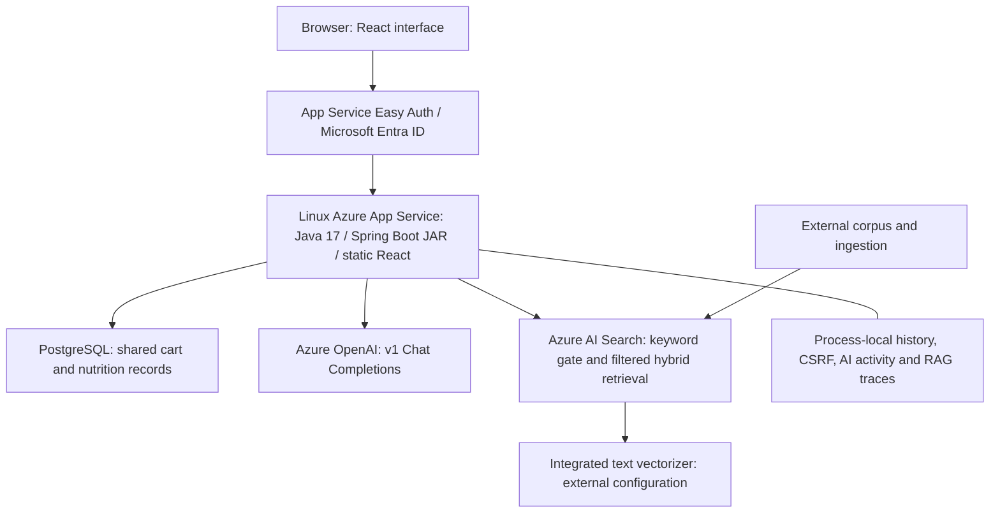

# Current Azure source architecture

This is the architecture indicated by the supplied application source and read-only Azure observations. Evidence limits are in `source-fidelity.md` and `azure-observed-state.md`.

## Application request flows

- Cart CRUD persists shared cart items through Spring Data/JPA.
- Recipe and original nutrition recommendations send cart item names to Azure OpenAI and parse JSON output.
- Product facts and confirmed grams are calculated locally by Java from database records. Counts are not weights.
- Grounded chat obtains current product facts, performs Azure Search keyword retrieval, then filtered hybrid retrieval over lexically supported chunks. The Search index supplies integrated query vectorization.
- Retrieved passages, current facts, computed comparisons/totals, and recent session history are assembled for Azure OpenAI. Structured answer/citation fields and numeric-value presence are checked before returning an answer.
- Microsoft identity enforcement occurs at App Service; chat adds a single-owner header check, CSRF, and origin validation. See `authentication.md`.

## Hosted configuration used for assessment

`SPRING_PROFILES_ACTIVE=azure`, `SHOPPING_CART_AI_MOCK=false`, and `CHAT_ENABLED`, `CHAT_AI_ENABLED`, `RAG_ENABLED`, `NUTRITION_LOOKUP_ENABLED` all `true` were observed in the hosted settings. Use this configuration when assessing active features.

Observed hosting was Linux Java 17 on Basic B1 with one instance in Central US. Frontend and backend are served on the same origin. Deployed resource names and identity values are placeholders in the package.

| Component | Evidence and limits |
|---|---|
| React / Spring Boot | Source/build supplied; frontend packed into the service JAR; exact deployed binary match not established |
| App Service / Entra | Required sign-in, HTTPS, restricted principals and runtime hosting inspected read-only |
| PostgreSQL | Source JDBC/JPA integration and hosted datasource setting presence; contents/version/backups not exported |
| Azure OpenAI | HTTP clients, prompts, request fields, parsers; hosted endpoint/deployment/key settings present; live response/model version unverified |
| Azure AI Search | Actual adapter plus observed active-index fields, 1536-dimensional vector field, HNSW/cosine, configured query vectorizer and corpus version 1.1; no complete vectorizer/corpus/ingestion export |
| Sessions | Code retains per-session history/activity in-process; shared cart persists in the database |

The local H2/mock preview and HTTP test fixtures are development tools. They are not substitute Azure components and must not be represented as the deployed architecture. No new local RAG simulation is included.

Selected Search metadata is recorded in `azure/search-observed-state.json`. The active index has ten indexed records. Search runs on Free tier in Central US with one replica and one partition. The configured query vectorizer is observed, while its embedding deployment/model parameters remain unverified.
